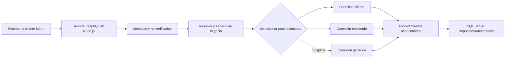

# Análisis del enunciado

Análisis inicial: 21 de octubre de 2026. Actualización por adopción de RepuestosAutomotrices: 22 de octubre de 2026. Fuente: [Tarea programada 2.pdf](../requeriemientos/Tarea%20programada%202.pdf), cinco páginas. Las decisiones del equipo se distinguen de las exigencias del documento. La conexión de mantenimiento y las dependencias se verificaron en el servidor el 22/10/2026. Los cambios funcionales y de seguridad permanecen pendientes; esta actualización solo modifica documentación y la plantilla de configuración.

## 1. Propósito y alcance

El proyecto 2 continúa el modelo, los procedimientos almacenados y la seguridad del proyecto 1. Tiene dos productos principales: una carga masiva documentada y un backend GraphQL que reutiliza esa base. La futura aplicación web consumirá estos servicios, pero su interfaz no es un entregable de este avance (p. 4).

**Obligatorio por el enunciado:** SSMS y bcp al menos una vez cada uno; evidencia por cada tabla; CRUD GraphQL por tabla; ejecución de procedimientos almacenados; conexiones SQL diferenciadas por rol; paquete final completo. Usar tecnologías distintas a las solicitadas o dejar tablas, procedimientos o APIs faltantes afecta la calificación (pp. 4–5).

**Decisiones del usuario:** desarrollos en Node.js; SQL Server con base `RepuestosAutomotrices`; conexión por Tailscale a `100.124.109.126,15002`; dos compañeros con reparto equilibrado. La conexión de mantenimiento ya fue validada desde este equipo; faltan las pruebas de las identidades de aplicación por rol y desde el segundo equipo. El nombre oficial de la base sustituye al supuesto inicial, según [la decisión registrada](../info_bd/BASE_DATOS.md).

**Propuestas de este análisis:** servicio modular con un endpoint `/graphql`, pools por rol, inventario trazable, revisión cruzada y calendario con cierre interno el 3 de noviembre. Ninguna de estas propuestas sustituye las exigencias del docente.

## 2. Matriz de requisitos y aceptación

| ID | Requisito | Fuente | Criterio verificable | Fase |
| --- | --- | --- | --- | --- |
| R01 | Continuar la estructura y procedimientos del proyecto 1 | p. 1 y p. 4 | Inventario completo de tablas, relaciones, SP y permisos; faltantes identificados y resueltos | F1, F4 |
| R02 | Preparar archivos Excel, CSV o TXT para carga masiva | p. 1 | Cada tabla tiene archivo original identificable, formato y filas esperadas | F3 |
| R03 | Usar SSMS y bcp al menos una vez cada uno | p. 1 | Hay una carga exitosa documentada por cada herramienta, además de cobertura del resto de tablas | F2, F3 |
| R04 | Documentar la carga de cada tabla | pp. 1–3 | Tabla, herramienta, archivo/hoja, proceso, resultado exitoso y consulta de datos finales | F3, F6 |
| R05 | Generar evidencia en Word o PDF, con portada e índice por tabla | p. 1 | Documento final legible con apartado por cada tabla inventariada | F6, F7 |
| R06 | Resolver agregar, modificar, borrar y consultar por cada tabla vía GraphQL | p. 4 | Matriz de tablas × cuatro operaciones completa, con pruebas y resultados | F4, F5 |
| R07 | Invocar procedimientos almacenados desde los servicios | p. 4 | Cada operación tiene SP real trazado; faltantes creados; código ejecuta SP parametrizados | F4, F5 |
| R08 | Consultas preparadas para crecimiento futuro | p. 4 | Queries organizadas por módulo y contratos claros; filtros futuros no requieren reescribir conexiones | F4 |
| R09 | Validar usuario y obtener rol cuando el dominio lo requiera | p. 4 | Flujo acordado de autenticación; se obtiene cliente/empleado y se verifica en cada solicitud | F2, F5 |
| R10 | Aplicar seguridad SQL con dos conexiones distintas por rol | p. 4 | Cliente y empleado usan identidades distintas y sus permisos se comprueban también en SQL | F2, F5 |
| R11 | Evaluar tercer rol genérico para acceso público | p. 4 | Decisión justificada; si aplica, tercera identidad, pool y pruebas con permisos mínimos | F1, F2, F5 |
| R12 | Probar servicios durante la clase de entrega | p. 5 | Colección o guion repetible con datos, resultados esperados y ambas identidades | F5–F7 |
| R13 | Script de SSMS con estructura y datos | p. 5 | Script incluye tablas, relaciones, SP y datos; se comprueba en una base de verificación | F6, F7 |
| R14 | Entregar originales de carga, evidencia y código de todas las APIs | p. 5 | Paquete completo, trazado al inventario y sin secretos locales | F6, F7 |
| R15 | Entregar en Teams el 4/11 a más tardar a las 9:00 a. m. | p. 5 | Directorio “entregable Proyecto 2” y confirmación real de entrega en plazo | F7, entrega |

El PDF no fija número de filas, número de tablas, ponderaciones de rúbrica, versión de SQL Server, framework Node.js ni una zona horaria. No se deben inventar esos datos. Los ejemplos de Libros y Subsistema de pp. 1–3 ilustran evidencias; **no demuestran que esas tablas existan en este proyecto**.

## 3. Dependencias del proyecto 1 y descubrimiento inicial

Se recibió un script de RepuestosAutomotrices y se contrastaron sus dependencias con el servidor. Se identificaron 23 tablas, 34 procedimientos, 13 triggers y 32 claves foráneas en el script. Los conteos del catálogo mostraron 105 filas preexistentes. La secuencia, el ensamblado y la función CLR ya estaban instalados; no fue necesario crear objetos ni cargar registros. El inventario inicial se encuentra en [INVENTARIO.md](../info_bd/INVENTARIO.md). El alcance mínimo previsto es de 92 operaciones CRUD GraphQL; no hay APIs implementadas todavía.

Quedan por cerrar los contratos completos de parámetros y resultados, la matriz de permisos, el reparto ponderado y los archivos originales/evidencias de carga. El dominio identificado comprende repuestos, compras, existencias por bodega, aseguradoras, casos, cotizaciones y ventas. El usuario realizará las cargas; los datos existentes no equivalen a evidencia académica de importación.

En F1, el equipo debe completar y revisar el inventario heredado:

1. Todas las tablas de negocio, sus esquemas, PK simples o compuestas, FK, columnas, tipos, nulabilidad, defaults, identidad y columnas calculadas.
2. Procedimientos y parámetros, resultados, reglas de negocio, transacciones y errores. Identificar cuáles cubren cada operación CRUD y cuáles faltan.
3. Usuarios y roles SQL con sus permisos efectivos. Separar identidades de desarrollo/carga de identidades de ejecución de la aplicación.
4. Datos existentes, necesidad real de cargar cada tabla y forma de evitar duplicados. Contar antes y después, sin borrar datos compartidos para repetir pruebas.
5. Orden de carga por dependencias. Si hay ciclos de FK, diseñar una estrategia válida para ese modelo; no deshabilitar restricciones de forma general como atajo.
6. Necesidad de usuario genérico, mecanismo de login, operaciones públicas y credenciales de demostración sin datos sensibles.

El resultado se registra en [INVENTARIO.md](../info_bd/INVENTARIO.md). El conjunto de tablas inventariado será el denominador para medir carga y cobertura de APIs.

## 4. Diseño de la carga masiva

Preparar archivos por tabla en un orden que respete padres e hijos. Registrar codificación, delimitador, terminadores de línea, encabezados, representación de NULL, formatos de fecha/decimales y tratamiento de identidades. No convertir ceros iniciales, fechas o identificadores accidentalmente al abrir Excel.

Realizar un piloto con SSMS y otro con bcp en tablas seleccionadas tras conocer el modelo. Verificar mapeo de columnas y tipos antes de cargar el resto. SSMS y bcp deben insertar en las tablas correctas de `RepuestosAutomotrices`, no en tablas temporales creadas por error por el asistente.

Según la [documentación de bcp](https://learn.microsoft.com/en-us/sql/tools/bcp/bcp-utility?view=sql-server-ver17), el archivo no contiene por sí mismo el esquema de destino: hay que conocer columnas y tipos o definir el formato. Elegir el formato con base en los datos reales. Un CSV con comillas y delimitadores dentro de un campo requiere tratamiento explícito; no asumir que se importa correctamente solo por usar extensión `.csv`.

Por cada tabla guardar: archivo fuente y hoja si aplica; filas esperadas; conteo previo; filas importadas reportadas por la herramienta; conteo posterior; validación de claves y relaciones; capturas de origen, destino, resumen exitoso y datos finales. Un mensaje de éxito sin comprobar las filas y el destino no cierra la tarea. Un fallo se registra, se corrige y se acompaña de la ejecución final exitosa.

La evidencia de bcp debe mostrar instrucción, parámetros y resultado, evitando contraseñas en la línea de comandos. Usar el mecanismo de autenticación aprobado por el equipo y ocultar secretos en capturas. No confundir la cuenta de importación con las cuentas restringidas de cliente y empleado.

**Repetición segura:** acordar ventanas de carga, registrar qué archivo ya se aplicó y no ejecutar simultáneamente importaciones sobre la misma tabla. Probar reejecución y exportación en una copia cuando corresponda. No vaciar tablas ni sobrescribir permisos en la base compartida como parte de esta preparación.

## 5. Arquitectura propuesta del backend Node.js



Se propone un servicio con módulos por tabla, no un proceso independiente por tabla. La frase “una API por tabla” se interpreta como cobertura funcional de cada tabla mediante queries y mutations propias. Confirmar esta interpretación con el docente en F1; si exige otra organización, ajustar sin perder GraphQL, SP ni separación de conexiones.

Estructura sugerida para la implementación posterior:

```text
src/
  config/              # Validación de variables de entorno
  db/                  # Configuraciones y pools separados por rol
  auth/                # Identidad, sesión y autorización
  graphql/             # Schema raíz y composición de módulos
  modules/<tabla>/     # Tipos, inputs, resolvers y servicios
sql/
  procedimientos/      # SP faltantes o ajustes revisados
  verificacion/        # Consultas de control y permisos
datos/carga/           # Archivos originales de cada tabla
evidencias/             # Capturas finales por tabla
pruebas/               # Operaciones GraphQL y resultados reproducibles
entregables/           # Paquete académico final revisado
```

Estas carpetas describen la arquitectura futura; no representan código ya implementado. La elección de biblioteca GraphQL y versiones queda para F2, fijando dependencias y su lockfile. Se propone `mssql`, cuyo [repositorio oficial](https://github.com/tediousjs/node-mssql) documenta pools y `request.execute()` para procedimientos almacenados. No usar un único pool global que cambie credenciales entre solicitudes.

Para cada tabla, definir un tipo de salida, inputs separados de alta/modificación, sus identificadores reales y cuatro operaciones. Una tabla puente con PK compuesta requiere sus componentes; una tabla con campos sensibles requiere limitar la salida. “CRUD por tabla” no significa que todos los roles deban poder ejecutar todas las operaciones.

Los resolvers deben validar entradas y delegar al servicio. Los servicios ejecutarán SP mediante parámetros tipados, sin concatenar valores ni permitir al cliente elegir libremente el nombre del SP. Reutilizar procedimientos existentes y crear solamente los faltantes con revisión cruzada. Las lecturas de negocio también pasan por SP. Las consultas SQL de inventario o verificación no son endpoints de la aplicación.

Definir un contrato consistente de errores para datos inválidos, falta de permiso, registro inexistente, duplicado y conflicto de FK. Usar IDs y tipos adecuados para no perder precisión de `BIGINT` o `DECIMAL`. Acordar semántica de borrado según el modelo; no omitir la operación por ser difícil. La consulta por identificador y listado con límites son propuestas prácticas, no requisitos textuales de paginación.

## 6. Autenticación, roles y conexiones

Los roles cliente y empleado pertenecen a la aplicación; persona 1 y persona 2 son responsables del desarrollo. No asignar una conexión por compañero. Cada instancia del backend debe poder atender ambos roles con credenciales distintas, y el tercero únicamente si aplica.

El enunciado sugiere devolver un rol tras validar usuario y enviarlo en los pedidos siguientes. Para cumplir esa intención sin permitir suplantación, asociar el rol a una sesión o token verificado; no confiar en `rol=empleado` enviado libremente. El servicio debe seleccionar el pool a partir de esa identidad validada. GraphQL recomienda pasar la identidad autenticada al contexto y centralizar la [autorización en la lógica de negocio](https://graphql.org/learn/authorization/).

Resolver en F1/F2 cómo se valida el login con el modelo del proyecto 1 y qué identidad mínima puede ejecutar el SP de validación antes de conocer el rol. No usar por defecto la cuenta de empleado para autenticar a todo el mundo. No introducir una cuarta cuenta ni habilitar el usuario genérico sin revisar los permisos existentes. No se han definido tokens ni secretos de sesión en `.env`, porque el mecanismo aún no está acordado.

Verificar permisos efectivos de ejecución y acceso por procedimiento; no suponer que todos los SP respetan automáticamente el modelo de seguridad. Probar el efecto de la configuración real de ejecución de SQL Server. Nunca conceder `sysadmin` o `db_owner` para hacer pasar las pruebas. El aislamiento de datos de un cliente respecto a otro debe existir cuando lo requieran las reglas del proyecto 1, ya que compartir un pool de rol no identifica por sí mismo al cliente final.

Las variables comunes del `.env` se combinarán con `DB_CLIENT_*`, `DB_EMPLOYEE_*` y, opcionalmente, `DB_GENERIC_*` para construir conexiones distintas. Usuario y contraseña vacíos deben producir un error de configuración claro al implementar el arranque. No registrar configuraciones completas que incluyan contraseñas. Node.js permite cargar archivos de entorno y acceder a sus valores mediante `process.env`; ver su [documentación oficial](https://nodejs.org/api/cli.html#--env-filefile).

## 6.1. Estado heredado y ajustes pendientes

La dependencia CLR de autenticación está presente y su ejecución fue probada. Eso no acredita todavía login completo de aplicación ni permisos por rol. DB_SETUP es mantenimiento y debe mantenerse separado de las cuentas cliente/empleado. El servidor utiliza cifrado con confianza explícita en su certificado; `.env.example` refleja esa configuración.

Los ajustes BD01–BD07 del [registro de base oficial](../info_bd/BASE_DATOS.md) se incorporan a F1–F5: permisos por rol, IDs y errores de SP, campos NULL, consultas con salidas controladas, protección de totales/inventario/auditoría y estrategia de carga con triggers. No se han aplicado esas modificaciones funcionales.

## 7. Estrategia de verificación

| Área | Pruebas necesarias | Evidencia |
| --- | --- | --- |
| Entorno | Acceso desde ambos equipos; SQL responde en el puerto; autenticación y permisos de cada identidad | Registro sin secretos; la prueba TCP sola no valida SQL |
| Carga | Conteos antes/después, tipos, NULL, PK, FK, caracteres especiales y valores límite | Capturas y resultados por tabla |
| CRUD | Alta → consulta → modificación → consulta → borrado → comprobación de ausencia, con datos de prueba trazables | Operaciones y respuestas de todas las tablas |
| Validación | ID inexistente, duplicado, requerido ausente, dato inválido y conflicto referencial | Error esperado y ausencia de cambios indebidos |
| Seguridad | Operación permitida y denegada por rol, rol manipulado, sesión inválida y concurrencia cliente/empleado | Resultado de API y prueba de permisos SQL |
| Rol genérico | Solo si aplica: lectura/registro permitido y operaciones sensibles denegadas | Casos positivos y negativos |
| Exportación | Script SSMS con estructura y datos, objetos requeridos y ejecución en base de verificación | Conteos y comprobación de SP sin tocar el servidor compartido |
| Demostración | Ejecución reproducible desde los dos equipos | Guion y colección sin secretos |

Las pruebas deben invocar la API y comprobar el efecto real en SQL; devolver HTTP 200 no basta para acreditar éxito de una operación GraphQL. Las pruebas de borrado no se hacen sobre información compartida necesaria para la carga o la demostración.

## 8. Riesgos y decisiones pendientes

| Riesgo o incógnita | Impacto | Acción y responsable |
| --- | --- | --- |
| Contratos y permisos del modelo heredado sin cerrar | Confundir objetos existentes con funcionalidad terminada | Revisar el inventario de 23 tablas y 34 SP; conciliar en F1 |
| Dos accesos personales sin identidades SQL por rol verificadas | Incumplir conexiones diferenciadas | Persona 2 revisa mapeo; persona 1 prueba permisos en F2 |
| Rol enviado sin validación | Suplantación y acceso indebido | Persona 2 diseña identidad; persona 1 realiza pruebas de manipulación |
| Volumen o complejidad desigual de tablas | Carga desequilibrada y retrasos | Ponderar paquetes en F1, revisar esfuerzo diariamente y redistribuir |
| FK, identity, tipos o caracteres incompatibles | Fallos o datos alterados en importación | Ambos validan pilotos y formatos antes de carga general |
| Configuración TLS distinta entre equipos | Fallo al conectarse con la plantilla equivocada | Usar las opciones acordadas de cifrado y confianza en certificado; comprobar el segundo equipo |
| Cambios simultáneos en BD compartida | Colisiones de cargas, SP o datos de prueba | Dueño por tabla, ventanas coordinadas y scripts revisados |
| Evidencia incompleta o solo Markdown | Entregable obligatorio incumplido | Capturar al ejecutar y convertir plantilla a Word/PDF en F6 |
| Exportación sin datos o sin SP | Paquete no reproducible | Revisar opciones SSMS y probar en copia en F6 |
| Hora del curso no confirmada | Entrega tardía | Confirmar zona y horario en F1; terminar el día anterior |

## 9. Definición global de terminado

No se considera terminado por tener un servidor funcionando o un README completo. Se requiere: inventario cerrado; datos de todas las tablas cargados con las dos herramientas demostradas; evidencia final Word/PDF completa; cuatro operaciones GraphQL por tabla invocando SP; seguridad demostrada con conexiones por rol; originales y script SSMS con estructura y datos; código reproducible; guion de prueba; revisión cruzada y entrega real en Teams.

Los documentos de planificación no sustituyen esos productos. [PROGRESO.md](../markdowns/PROGRESO.md) parte de **0/96 puntos de ejecución** aunque esta preparación documental ya esté hecha.
